# Browser extension: technical design

How the Stardust browser extension (`subscriber-client/browser-extension/`) measures AI chat usage on ChatGPT, Claude and Gemini, what it sends to Stardust Core, and how it is built, tested and released. Spec references: §12.3–§12.4 (browser fallback path), §8.3 (confidence tiers), §14.1 (privacy).

**Status:** version 0.1.1 is released ([`extension-v0.1.1`](https://github.com/AIforEcology/stardust/releases/tag/extension-v0.1.1)). `main` is at 0.1.2, which adds the per-tab status line ([§9](#9-failure-modes-and-diagnostics)) and the calculator's measures under **More detail**. The revoked-key handling in [§3.6](#36-rejected-keys-unknown-vs-revoked) is PR #44. The diagrams are Mermaid, which GitHub draws as pictures.

**Contents**

1. [Goals and constraints](#1-goals-and-constraints)
2. [Architecture](#2-architecture)
3. [Workflows](#3-workflows)
4. [Deciding which replies are new](#4-deciding-which-replies-are-new)
5. [Estimating tokens](#5-estimating-tokens)
6. [Data model](#6-data-model)
7. [Privacy and security](#7-privacy-and-security)
8. [Site adapters](#8-site-adapters)
9. [Failure modes and diagnostics](#9-failure-modes-and-diagnostics)
10. [Build, test and release](#10-build-test-and-release)
11. [Known limits and open issues](#11-known-limits-and-open-issues)

## 1. Goals and constraints

| Goal | How the design meets it |
|---|---|
| Show the cost, electricity, carbon and water behind each AI chat reply | Each finished reply becomes one usage event. Core enriches it and the popup and badge show the result |
| Never send what people write | The page script sends **character counts and the model name only**. Message text never leaves the page (§14.1) |
| Measure only with consent | Off by default, switched on **per site** by the user |
| Be honest about accuracy | Chat sites don't show token counts, so tokens are estimated and every event is tagged `tokens_estimated` and **Estimated** (§8.3) |
| Count only new usage | History that loads late (opening a chat, scrolling up) is never counted. See [§4](#4-deciding-which-replies-are-new) |
| Survive site redesigns | All page knowledge lives in one file of per-site adapters ([§8](#8-site-adapters)) |
| Work with any Stardust Core | Default to the hosted Core, allow localhost, and allow any other Core only with the user's explicit browser permission |
| Pass store review | Manifest V3, no remote code, minimal permissions with written justifications (`store/PERMISSIONS.md`) |

## 2. Architecture

### 2.1 Components

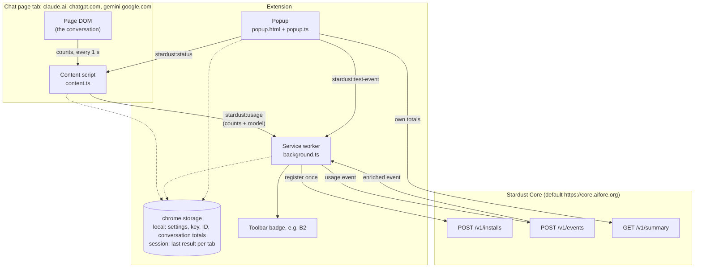

Dotted lines are reads and writes to browser storage (see [§6.1](#61-browser-storage)).

### 2.2 Modules

| File | Runs in | Responsibility |
|---|---|---|
| `static/manifest.json` | — | MV3 manifest: permissions, content-script matches, popup, service worker. `build.mjs` sets the version and adds the default Core's host permission |
| `src/content.ts` | Chat page | Polls the page each second, finds finished new replies, computes input and output characters, sends `stardust:usage`. Answers `stardust:status` (0.1.2) |
| `src/sites.ts` | Chat page | Per-site adapters: selectors for replies, user turns, streaming flag, model label, and model-name parsing |
| `src/turns.ts` | Chat page | Which text in a turn counts (answer only, typed text only). Pure and unit-tested |
| `src/tracker.ts` | Chat page | `ReplyTracker`: decides when a reply is finished **and** new. Pure and unit-tested |
| `src/context.ts` | Chat page | Running per-conversation context totals, hidden-turn estimate, reply fingerprint. Pure and unit-tested |
| `src/estimate.ts` | All | 4 characters per token, and ISO timestamps with the local UTC offset |
| `src/background.ts` | Service worker | Rechecks opt-in, builds the usage event, sends it to Core, stores the result per tab, sets the badge. Handles the Test button |
| `src/settings.ts` | All | Settings in `chrome.storage.local`, per-Core credentials, `coreFetch` with one re-registration on 401 |
| `src/popup.ts` | Popup | Per-site switch, tab status, last reply, the user's totals (each with a **More detail** panel), Core address, Test button, version |
| `src/format.ts` | Popup, worker | Number formats, badge text and colors, energy-source wording that never overstates a plurality source (§5.3.3), and the Token Cost Calculator's comparisons: indicator code spelled out, fossil-fuel CO₂ and young-forest area |
| `src/types.ts` | All | Event, summary and message types, mirroring `schema/*.schema.json` |
| `build.mjs` | Build | esbuild bundling into `dist/`, default Core address, manifest version |
| `scripts/screenshots.mjs` | Build | Store screenshots: renders the real popup with stubbed `chrome.*` and `fetch` |

The three page-side logic modules (`tracker`, `context`, `turns`) don't touch the DOM directly, so they are tested with plain objects (`npm test`).

## 3. Workflows

### 3.1 Install and registration

Nothing is sent when the extension is installed. On the first request that needs Core (a usage event, the Test button or the popup's totals), `getCredentials` registers the install.

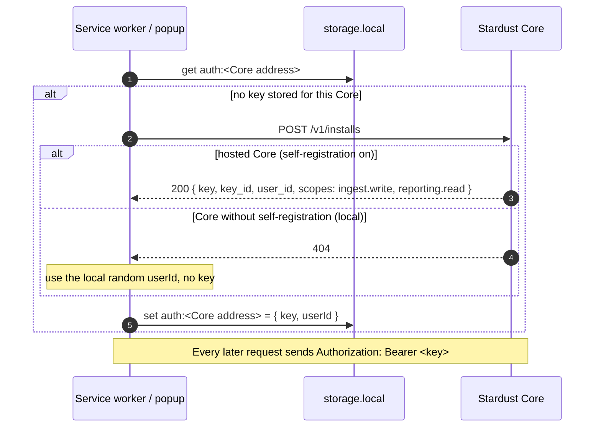

Keys are stored **per Core address**, so switching to a self-hosted Core never sends it the hosted key. Hosted Core rate-limits registrations per IP (`STARDUST_REGISTRATIONS_PER_IP_PER_HOUR`).

### 3.2 Turning measurement on for a site

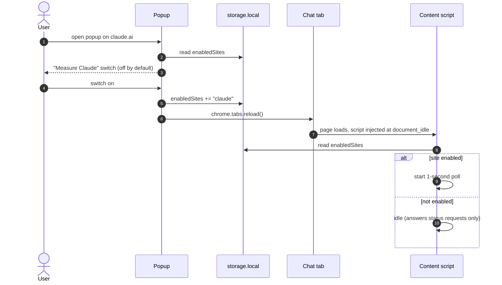

The content script reads the switch **once, at page load**, so the popup reloads the tab after every change. The service worker checks the switch again for each report, so a page loaded before opt-out can't keep reporting.

### 3.3 Measuring a reply

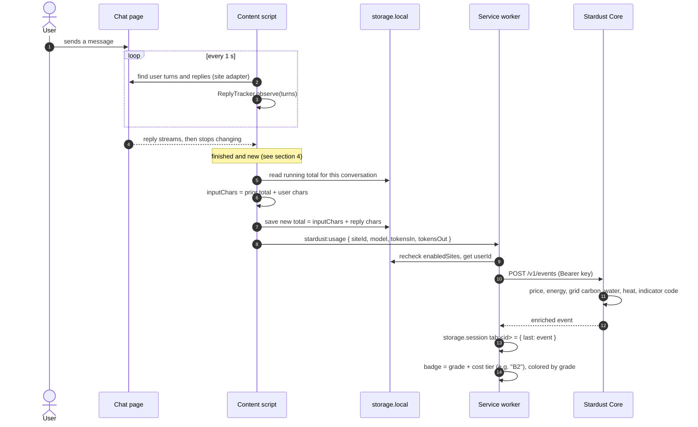

What the service worker sends for one claude.ai reply:

```json
{
  "source_layer": "browser_ext",
  "provider": "anthropic",
  "model": "claude-opus-5-5",
  "timestamp": "2026-10-21T14:24:05.123-07:00",
  "tokens_in": 8,
  "tokens_out": 300,
  "tokens_estimated": true,
  "user_id": "c1b79ccc-5850-41bb-a8bc-3168b32565d0"
}
```

### 3.4 Opening the popup

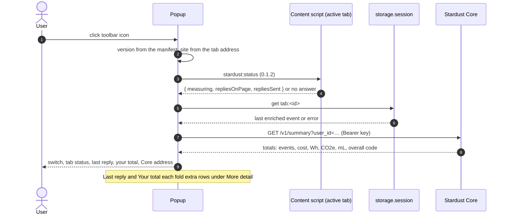

### 3.5 Test button

The **Test** button sends a fixed, priced sample (Claude Sonnet 5.5, 1,000 tokens in and 250 out) through the same path as a real reply (§3.3, from step 9 on). It checks the connection, the key and Core's enrichment without a chat. The popup waits for the service worker to answer before redrawing.

### 3.6 Rejected keys: unknown vs revoked

Core answers both an unknown key and a revoked key with `401 unauthorized`. For a revoked key it adds `"key_revoked": true` to the body, checked only after the key's hash matches, so only the key's holder learns it.

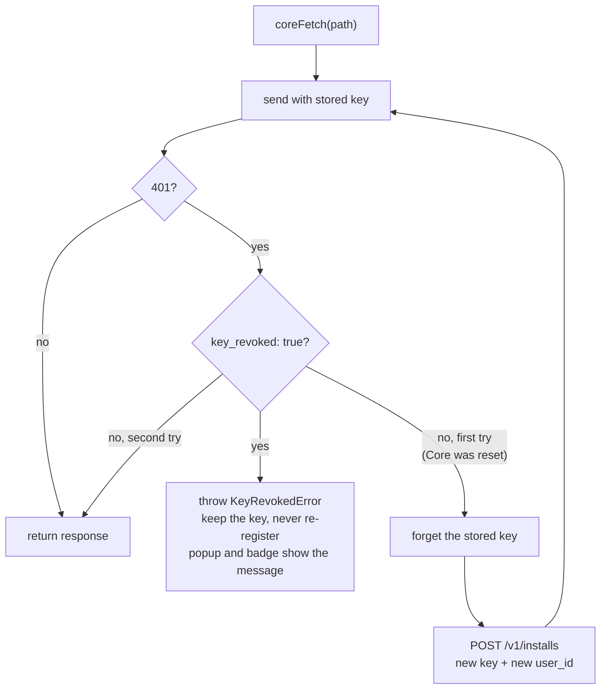

An operator's revocation therefore sticks. Before PR #44 the extension re-registered after any 401, so a revoked install fetched a new key and carried on, with its totals restarting under a new ID.

### 3.7 Using a self-hosted Core

The user types a Core address in the popup. Localhost and the default Core need no prompt. Any other address triggers `chrome.permissions.request` for that one origin, using the manifest's optional host permissions. Nothing changes if the user declines. Credentials are kept separately for each address.

## 4. Deciding which replies are new

Timing can't separate new replies from history: pages load old turns late, on opening a chat, when scrolling up (Gemini) and when switching chats. So `ReplyTracker` counts a reply only if there is evidence it was produced while the page was watched.

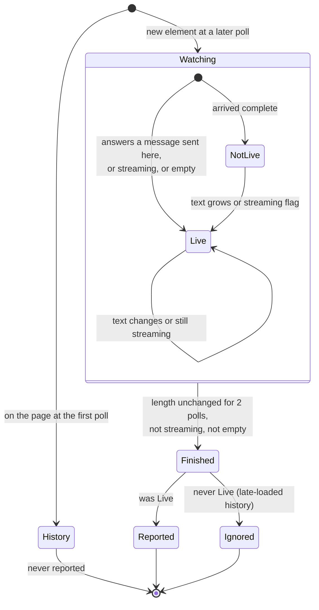

- **"Answers a message sent here"**: a user turn first seen at the bottom of the transcript with no reply after it is *pending*. The next new reply after it is live.
- **Finished**: the counted length is unchanged for 2 polls (about 2 s) and the site's streaming flag (claude.ai: `data-is-streaming`) is off. Replies that pause mid-stream aren't cut short.
- **Re-rendered replies**: virtualized transcripts unmount and remount turns. Each reported reply's fingerprint (`conversation + FNV-1a hash of the counted text`) is remembered for the page session, so a remounted reply isn't reported twice. The hash never leaves the page.

## 5. Estimating tokens

Chat apps resend the whole conversation as input on every turn. Pages like claude.ai keep only the last few turns in the DOM, so the extension can't simply count the page.

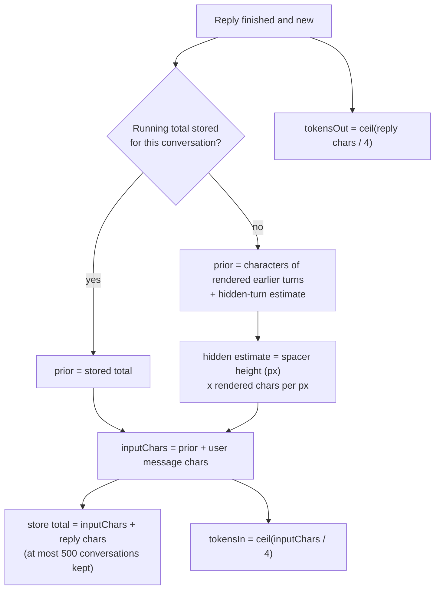

Example, three turns in one claude.ai conversation measured on 2026-09-24:

| Turn | User chars | Reply chars | Input chars | Running total after |
|---|---|---|---|---|
| 1 | 44 | 3,792 | 44 | 3,836 |
| 2 | 16 | 3,449 | 3,852 | 7,301 |
| 3 | 16 | 3,487 | 7,317 | 10,804 |

The conversation key is `site id + page path`, so each chat keeps its own total.

## 6. Data model

### 6.1 Browser storage

| Store | Key | Value | Written by |
|---|---|---|---|
| local | `enabledSites` | Site ids the user switched on, e.g. `["claude"]` | Popup |
| local | `userId` | Random UUID, used with a Core that issues no keys | Settings (first run) |
| local | `apiBase` | Core address, if the user changed it | Popup |
| local | `auth:<Core address>` | `{ key, userId }` from `POST /v1/installs` | Settings |
| local | `conversationChars` | `{ "<site>:<path>": running chars }`, up to 500 | Content script |
| session | `tab:<tab id>` | `{ last: EnrichedEvent }` or `{ error }` | Service worker |

Session storage is cleared when the browser closes, and each tab's entry when the tab closes.

### 6.2 Messages between the extension's parts

| Message | From → to | Payload |
|---|---|---|
| `stardust:usage` | Content script → service worker | `siteId`, `model?`, `tokensIn`, `tokensOut` |
| `stardust:test-event` | Popup → service worker | `tabId`; answered after Core responds |
| `stardust:status` (0.1.2) | Popup → content script | Answer: `siteId`, `measuring`, `repliesOnPage`, `repliesSent` |

### 6.3 Core API used

| Endpoint | Auth | Purpose |
|---|---|---|
| `POST /v1/installs` | None, rate-limited per IP | Register an install: user-level key with `ingest.write` and `reporting.read` |
| `POST /v1/events` | Bearer key | Send one usage event; returns the enriched event (`schema/enriched-event.schema.json`) |
| `GET /v1/summary?user_id=` | Bearer key | The install's own totals and overall indicator code |

The popup shows these enriched fields: `indicator_code`, `job_sji`, `model`, `tokens_in/out`, `cost_usd`, `energy_wh`, `co2e_g`, `water_ml`, `heat_rejected_wh`, energy source (`energy_source_code`, `grid_style`, `grid_majority_share_pct`, `grid_diversified`) and `confidence_tier`. Under **More detail** it adds the indicator code spelled out, the water split (`water_onsite_ml` cooling, `water_offsite_ml` power generation), and, computed in the popup with the Token Cost Calculator's constants, the CO₂ if the same electricity came from gas, coal or oil and the young-forest area that would absorb the CO₂e. Core also returns `grid_intensity_g_per_kwh`, `energy_mix_breakdown` and `model_tier`, which the popup doesn't show yet.

## 7. Privacy and security

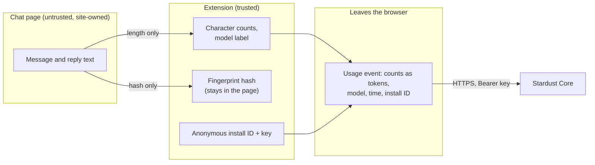

- **Never sent:** message or reply text, names, emails, account details, page URLs, browsing history. The conversation key (the page path) is used only in local storage.
- **Sent:** estimated tokens in and out, model name, timestamp with UTC offset, provider, anonymous install ID. Core stores the enriched event under that ID.
- **Permissions:**

  | Permission | Why |
  |---|---|
  | `storage` | Settings, key, conversation totals, per-tab results |
  | `tabs` | Read the active tab's address for the per-site switch, and reload it after a change |
  | Host `https://core.aifore.org/*` (added at build time), `localhost`, `127.0.0.1` | Reach the default Core and local Cores without prompting |
  | Optional `https://*/*`, `http://*/*` | Requested for one origin only, when the user enters a self-hosted Core |
  | Content scripts on the four chat hosts | Count characters and read the model label, only when switched on |

- **No remote code:** everything is bundled at build time. Store builds must use `https` (or localhost) for the default Core; `build.mjs` refuses anything else.
- **Key scope:** an install's key can only add its own usage and read its own totals. Admin endpoints are blocked at the hosted Core's proxy.
- **Retention and deletion:** set by the Core operator. On the hosted Core, events are kept two years; deletion is by request with the install ID ([privacy policy](https://aifore.org/stardust/privacy)).

## 8. Site adapters

Each chat site is one `SiteAdapter` in `src/sites.ts`:

| Field | Purpose |
|---|---|
| `hosts` | Page hosts the adapter applies to |
| `assistantSelector` / `userSelector` | One element per reply / per user turn, in document order |
| `replyTextSelector` / `userTextSelector` | Optional: only these parts are counted (skips hidden headings, status lines, buttons, screen-reader copies) |
| `streamingAttr` | Ancestor attribute that is `"true"` while a reply streams |
| `spacerSelector` | Placeholders for turns a virtualized transcript hasn't rendered |
| `modelSelector` + `parseModel` | The page's model label, turned into an API model id |
| `replyModel` | The model per reply, when the page records it (ChatGPT) |
| `verified` | Date the selectors were last checked on the live site |

Current adapters:

| Site | Replies | Counted text | Model | Verified |
|---|---|---|---|---|
| claude.ai | `[data-testid="assistant-message"]` | `.standard-markdown`, `.progressive-markdown` | Model picker label, e.g. "Opus 5.5" → `claude-opus-5-5` | 2026-10-21 |
| ChatGPT | `[data-message-author-role="assistant"]` | Whole element | Per reply, `data-message-model-slug` (`gpt-5-6` → `gpt-5.6`) | 2026-09-24 |
| Gemini | `model-response message-content` | Whole element; user text from `.query-text-line` | Mode only ("Flash") → `gemini-flash`, so no price | 2026-09-24 |

### 8.1 When a site changes its markup

Chat apps redesign often, and a selector that matches nothing fails silently. On 2026-10-21, claude.ai replaced `.font-claude-response`, and the extension measured nothing until the adapter was updated (PR #41).

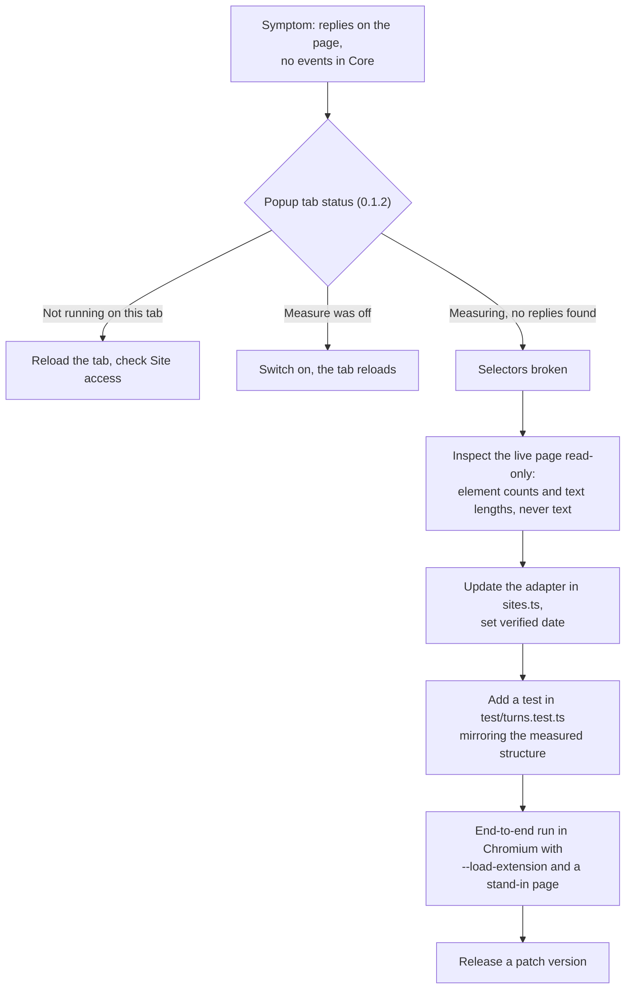

## 9. Failure modes and diagnostics

| Symptom | Likely cause | What shows it | Fix |
|---|---|---|---|
| Badge never changes, total doesn't grow | Selectors no longer match (site redesign) | Tab status: "Measuring this tab, but no replies found" (0.1.2) | Update the adapter (§8.1) |
| Same, after installing or updating | The tab was open before the extension loaded; old tabs keep the old script | Tab status: "Not running on this tab yet" | Reload the tab |
| Same, with Measure on | Chrome's Site access for Stardust is "On click" or limited | Tab status: "Not running on this tab yet" | Site access: On all sites |
| Total restarts at zero | New install ID: the extension was removed and re-added, or Core was reset and the install re-registered (§3.6) | Install ID in the popup changes | Expected in those cases |
| "This install's key was revoked…" and badge `!` | The Core operator revoked the key | Last reply and Your total show the message | Contact the operator; the extension won't re-register on its own |
| "Cost: unknown (model not priced yet)" | Core has no price for the model | Last reply | Core's daily price refresh, or the vendored price file |
| "Cost: unknown (no model to price)" | The page didn't show a model the adapter could read | Model: "not detected on this page" | Update `modelSelector` / `parseModel` |
| Badge "!" | Core unreachable or returned an error | Last reply shows the error | Check the Core address and Core's `/healthz` |

## 10. Build, test and release

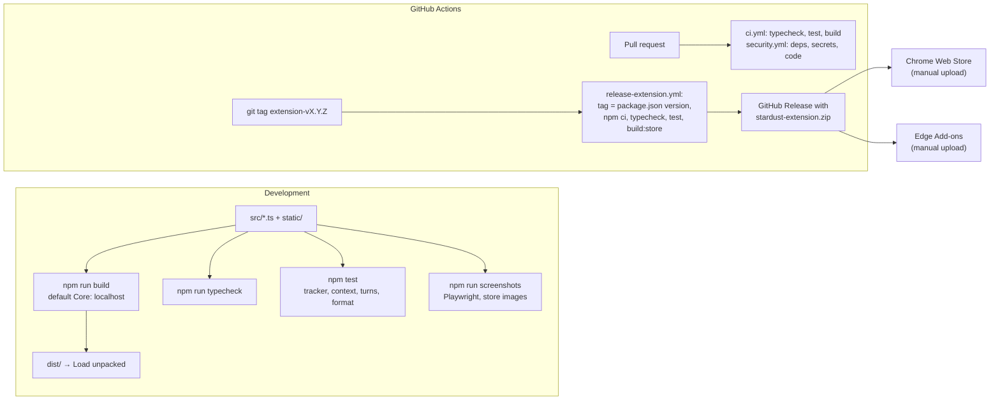

- `npm run build:store` sets the default Core to `https://core.aifore.org` (or `STARDUST_API_BASE`), adds its host permission and writes `stardust-extension.zip`.
- The version lives only in `package.json`; `build.mjs` copies it into the manifest and the popup shows it.
- **End-to-end check before a release:** load `dist/` in Playwright's Chromium with `--load-extension`, route the chat host to a stand-in page that replays a measured reply sequence, and confirm the service worker stores an enriched event from Core. Revoke the test install's key afterwards.
- Store uploads are manual for now. The Chrome Web Store and Edge Add-ons publish APIs can be wired into the release workflow later with repository secrets.

## 11. Known limits and open issues

| Area | Limit or issue | Impact | Direction |
|---|---|---|---|
| Accuracy | Thinking and reasoning tokens aren't on the page | Output undercounted for thinking models | Use SDK or API usage where available (Measured tier) |
| Accuracy | System prompts, attachments and tool results aren't counted | Input undercounted | Document; per-site heuristics later |
| Accuracy | Edited or retried messages start a branch, but the running total keeps the old one | Later input overcounted | Key totals by branch, or re-measure on edit |
| Accuracy | 4 characters per token is an English-text rule of thumb | Other languages and code differ | Per-language factor, or a bundled tokenizer |
| Robustness | Selectors drift with site redesigns and fail silently | No measurement until fixed | Status line (0.1.2); a scheduled live-selector check |
| Robustness | ChatGPT and Gemini adapters last verified 2026-09-24 | May be broken | Re-verify, as for claude.ai on 2026-10-21 |
| Robustness | Open tabs keep the old script after an update | No measurement until reload | Status line tells the user; could re-inject on update with `scripting` |
| Security | Fixed in PR #44: revoked keys no longer re-register (§3.6). Copies of 0.1.1 already installed still do until users update | A revoked 0.1.1 install can register again | Ship 0.1.3+; per-IP registration limits on Core meanwhile |
| Product | The popup's comparison constants are copied from the website calculator | The two can drift apart | Move the fossil and forest factors into `schema/factors/methodology-*.json` and read them in both |
| Product | Grid intensity, energy mix and model size tier aren't shown | Less insight into why a code is high | Add to **More detail** ([§6.3](#63-core-api-used)) |
